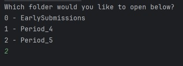
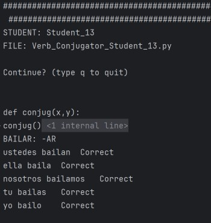
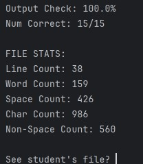
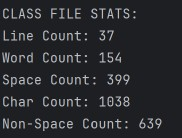

# Verb Conjugator Project with Assignment Checker

- Automates the grading of student-submitted project files for AP Computer Science Principles (for 81 total students across 5 class periods).
- Students implement functions and string slicing in Python to correctly conjugate regular verbs in Spanish.
- Students will write a program that takes in a pronoun and an infinitive verb as inputs to the function. The function should return a new pronoun-verb pair with the **_conjugated verb._**

## What students learn:

- String analysis and manipulation with slices and indexes.
- Apply if statements to check pronoun-verb pairs and apply the correct logic for conjugation.

## What I learned:

- Automated the retrieval and execution of student Python submissions across a directory tree. This drastically **reduces the burden involved in the grading process** by eliminating the need to manually locate, open, and run the code of 81 individual programs. Students could be graded with more precision in less time (from 30 minutes to 4 minutes per student)
- Implements batch testing using approximately 200 predefined input cases per submission to evaluate Spanish verb conjugation across regular -ar, -er, and -ir verbs.
- Streamlined the assessment workflow by consolidating repetitive file management, program execution, and correctness checks into a single automated process.
- Improved the consistency and precision of assessments through automated testing.
- Applied Bash scripting to automate the naming of submissions and Python files.

## Files

- **Period 4-8, Early** - Sample python solutions organized into different class folders.
- **ConjugatorChecker.py** - Checks the submissions of each submission in a specified class.
- **Ifs and Slices: Spanish Verb Conjugator.docx** - Lab Instructions and Rubric
- **RegVerbs** - A list of regular spanish verbs to check against the students submissions.
- **RegVerbsShort** - A short list of 3 spanish verbs.

### _Ifs and Slices: Spanish Verb Conjugator_

- The instructions and rubric of the lab.
- Students are to complete the lab planning by hand and have it initialed by me first before moving on to code, allowing me to document rates of completion in class with consistency.
- Students are given a sample test (a script) to run in their own programs to verify whether their program runs correctly for all cases before the due date.

### How to use _ConjugatorChecker.py_

1. After running the program, select a class from the menu.   
   

   
2. The program will then go through each students files, checking the output of their functions against a key with **_RegVerbs_**. Press enter to make your way through each student.  The results of each check are displayed as a percentage in the output before continuing to the next student.  
                

   
3. **File Stats** are also displayed to show the number of lines, words, spaces, characters, and non-space  characters appear in the file.  There is an option to read through the submission at the end of each check for a closer look at each submission.  
        

   
4. When complete with a class, the **classes average stats** are also displayed.
       

## Later Improvements:
- I eventually add a way to choose where in a class you would like to start to be able to stop grading and come back later with ease. This also helps account for the challenge that sometimes an error can occur and terminate the grading process.
